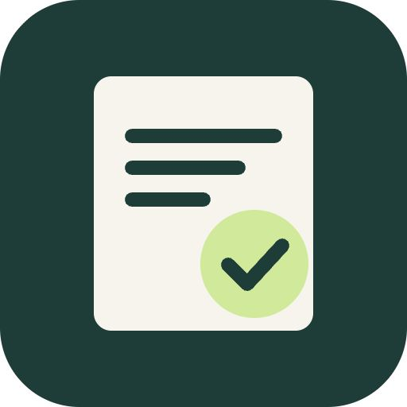
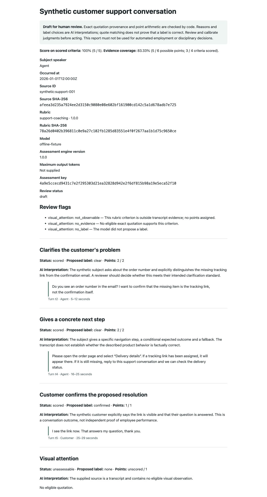

# Evidence QA v1

## Conversation Reviews with Checked Quotes

Define your conversation review criteria. Get an AI draft with checked transcript excerpts, code-calculated points, separate coverage, and a Google report and Sheet row.

**Evidence QA v1 is a $59 one-time paid technical source kit.** This public repository contains documentation, fictional examples, and a synthetic report preview. The implementation is delivered in the purchased ZIP; runtime scripts, tests, the setup skill, and the n8n workflow are not included here. No client conversations, account identifiers, credentials, or historical client outcomes are included.

The paid Agensi listing link will be added after its publication is verified.

### The outcome you buy

| Review task | V1 outcome |
| --- | --- |
| Start from a blank scorecard. | A draft against your own versioned rubric. |
| Find supporting passages. | Exact excerpts with cited turns and speakers. |
| Add points and handle gaps. | Deterministic arithmetic with score and coverage shown separately. |
| Copy drafts between tools. | Buyer-configured Zoom → OpenAI → Google Docs and Sheets publication. |
| Recover a failed output. | Saved assessment and destination publication state; resume output without re-running the model after the checkpoint. |

**Correctness:** code checks the rubric contract, allowed labels, exact Unicode excerpts, permitted speakers, and point arithmetic. Review requests and unsupported evidence leave criteria unscored. Quote matching proves provenance; a reviewer still decides whether the label is justified.

**Speed:** repeated draft preparation and publication run automatically. The paid kit includes an offline synthetic benchmark. Live model latency, provider availability, cost, reviewer effort, and time savings must be measured in the buyer's environment; no universal savings figure is claimed.

**Automation:** the complete paid source includes provider adapters, an authenticated local HTTP engine, local one-writer recovery state, a setup skill, tests, and an inactive n8n schedule. Configure your own accounts and complete a live smoke test before scheduling real work.

### See a concrete draft

The fictional support example produces **5 points out of 5 assessed points, with 83.33% of the full rubric's 6-point weight covered**. Three criteria have checked excerpts. Visual attention remains unscored because the transcript cannot show it. Every output remains a draft for human review.

[Read the demo](docs/demo.md) · [Example rubric](examples/support-rubric.json) · [Fictional transcript](examples/support.vtt) · [Synthetic model reply](examples/assessment.json)

### Who it fits

A technical operator or QA lead with technical help who prepares support, sales, or coaching conversation reviews against a documented rubric. V1 helps reviewers start from an evidence-linked draft. It does not supply a validated universal employee-performance score or decide employment eligibility, pay, promotion, or discipline.

The example support rubric demonstrates the format. Calibrate your own criteria on reviewed examples before drawing conclusions. Contract and synthetic adapter tests establish local behavior; actual n8n import/execution and live Zoom/OpenAI/Google operation were not verified for this release.

### What you need for live operation

- Node.js 22+ and a machine or service to run the purchased implementation.
- Zoom cloud-recording transcripts, account/API eligibility, and an account-authorized server-to-server OAuth application with the needed current scopes.
- An explicit transcript speaker label for the person reviewed. A configured mapping does not prove real-world identity.
- An OpenAI API account/key and a model compatible with Responses and strict structured output.
- A Google Cloud project with Drive and Sheets APIs, your OAuth client/consent setup, and an offline refresh token.
- An existing empty draft Sheet tab and a report folder accessible to the same OAuth application. Ownership alone does not establish `drive.file` app access.
- A rubric, authorization to transfer the selected conversations to the configured providers, retention/access decisions, and a human review process.
- For scheduling: n8n or your own scheduler and a reachable authenticated engine endpoint; remote deployment needs your HTTPS/private access setup.

The offline demo in the paid kit needs no provider account or network access. Provider fees, hosting, OAuth setup, custom integration, custom rubric work, semantic calibration, and managed support are separate from the source-kit purchase. V1 assesses each eligible Zoom transcript file separately; it does not combine recording segments or include other live transcript-source adapters.

### Public manuals

- [Setup and provider prerequisites](docs/setup.md)
- [Define and validate a rubric](docs/rubric-guide.md)
- [What the checks establish](docs/evidence-and-limits.md)
- [Operation, scheduling and recovery](docs/operations.md)
- [Storage, privacy and retention](docs/privacy.md)
- [Support and version terms](docs/support.md)
- [Improvement and extension plan](docs/roadmap.md)

### First edition and paid extensions

V1 is the first standalone paid edition and remains usable without buying later editions. Updates published on the same Agensi listing are free to its owners under [Agensi's update terms](https://www.agensi.io/terms). Future major editions, domain packs, and a hosted edition, if released, will be separate optional paid purchases.

The [roadmap](docs/roadmap.md) prioritizes buyer setup/calibration and operational timing/usage telemetry for v1 updates, then a paid reviewer UI, durable workers, additional transcript sources, calibrated domain packs, and a hosted edition. These are proposed extensions with acceptance gates, not guaranteed dates or features.

Copyright © 2026 Stanislav Ivanov. Public documentation does not include or license the paid implementation. See [Copyright and product licensing](LICENSE.md).
