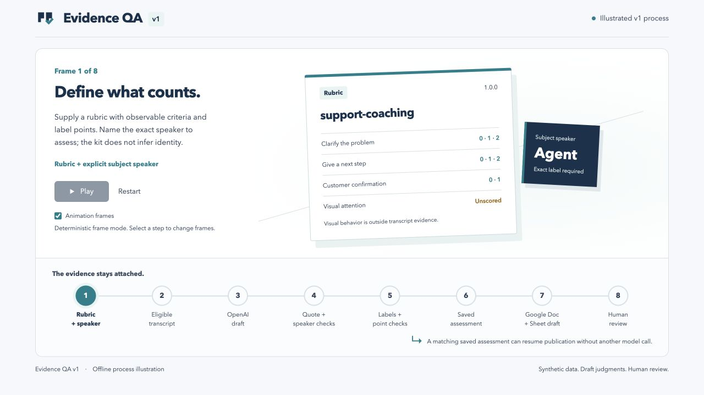
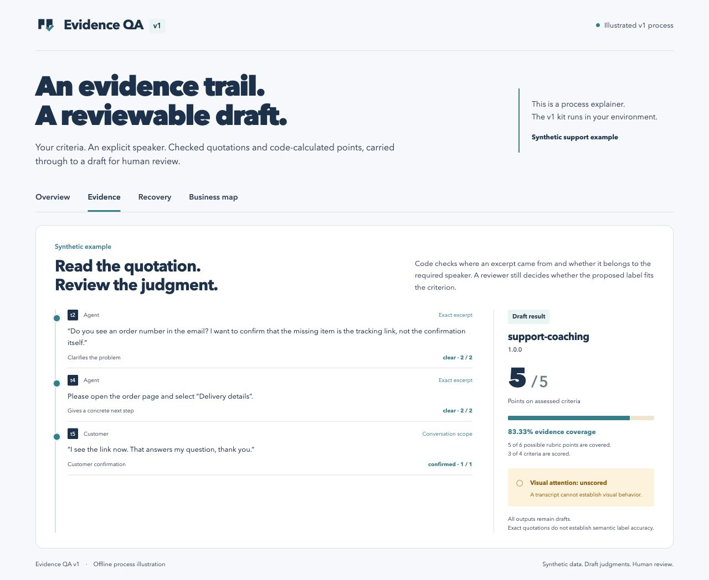
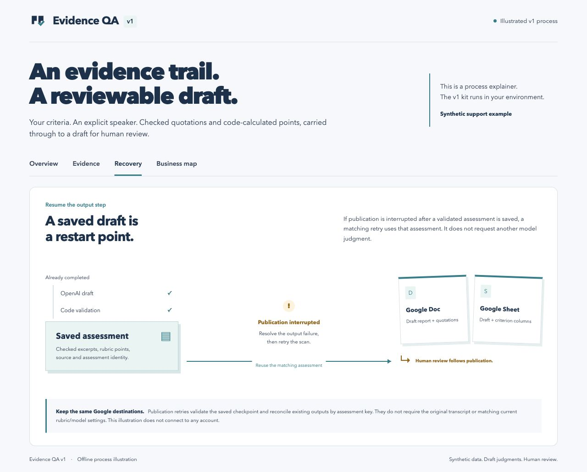
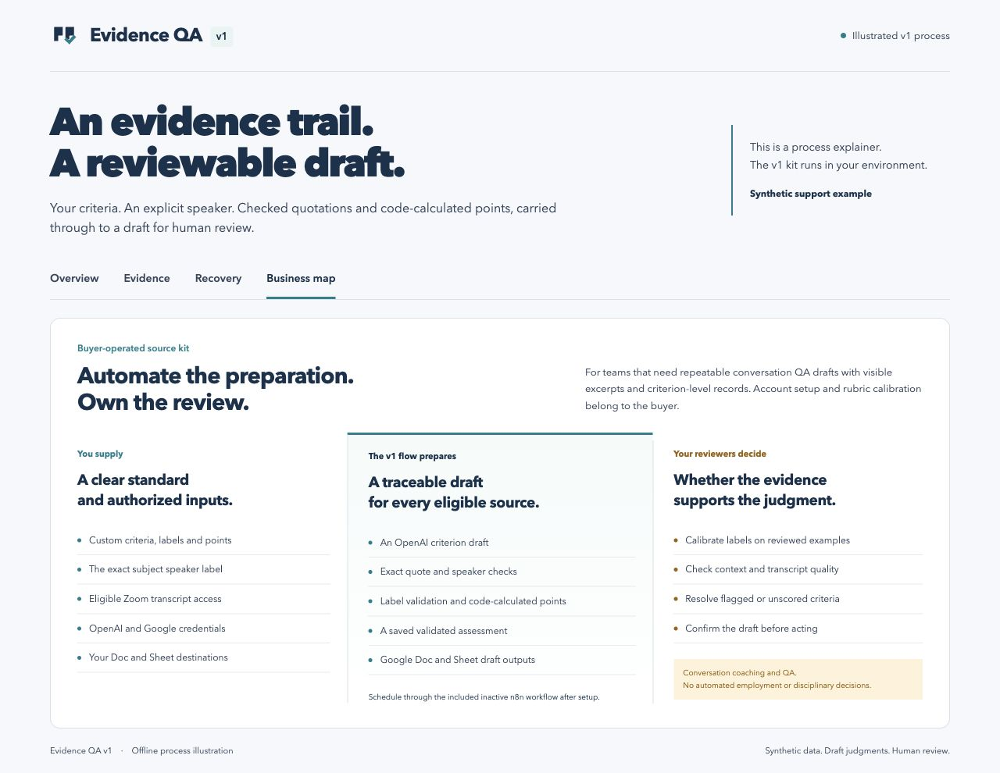

# See how v1 works

The visual guide follows three business outcomes: repeatable draft preparation, inspectable excerpts and arithmetic, and recovery of publication from a saved assessment. Navy gives the flow structure, teal connects automated steps, mint groups checked evidence, and amber marks work needing a person. These colors express states; they are not evidence of accuracy or a promise of commercial results.

## Explore the process

Open [the interactive illustration](media/workflow.html) in a browser from this folder. It works offline. Choose Overview, Evidence, Recovery or Business map; move through the stages or use Play, Pause and Restart. Playback is off initially and respects reduced-motion preferences.

The illustration explains implemented v1 behavior. It is not a screenshot of a shipped reviewer application or a recording of a live provider run. The only n8n export schedules an authenticated call to the buyer's Node engine. Human review happens in the buyer's own process.

[Watch the captioned process animation](media/workflow-process.gif). Use the static image above or the controllable HTML illustration if you prefer no motion. The animation is a single 36-second illustrated sequence, not measured execution time.

## Inspect the evidence

The fictional example scores **5 / 5 assessed points**, covers **83.33% of the full 6-point rubric**, and scores **3 / 4 criteria**. Visual attention remains blank because transcript text cannot establish it. Checked quotation provenance does not establish that an AI interpretation is justified. See [the actual synthetic report](demo-report.jpg) and [what the checks establish](evidence-and-limits.md).

## Recover publication

The saved assessment comes before Google publication. Pending outputs can resume from that checkpoint. An uncertain report creation must reconcile or stop for operator investigation; it does not blindly create another document. V1 supports one writer per local state directory. See [operations](operations.md).

## Connect functionality to business value

The map explains the implemented functions and their purpose. The [roadmap](roadmap.md) covers proposed future extensions and their acceptance gates. Future major editions, if released, are separate optional paid purchases; v1 listing updates are included under marketplace terms.

## Editable identity and design notes

- [Square vector mark](media/logo-mark.svg) and [marketplace logo image](media/logo-mark.jpg).
- [Horizontal vector lockup](media/logo-lockup.svg) and [lockup image](media/logo-lockup.jpg).
- [Identity preview, including small-size and white variants](media/logo-preview.html).
- [Visual design rationale, palette and accessibility checks](visual-design.md).

All media uses fictional data. Live Zoom/OpenAI/Google operation and actual n8n import/execution remain unverified for this release. No accuracy percentage, measured buyer time saving, or autonomous employment decision is represented.
